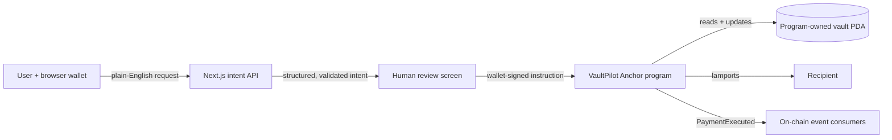

# VaultPilot

**AI payment intent. Human approval. On-chain guardrails.**

VaultPilot is a non-custodial Solana treasury that turns plain-English payment requests into reviewable SOL transactions. A custom Anchor program holds selected funds in a Program Derived Address (PDA) and enforces the owner's per-payment limit, UTC daily limit, pause switch, authority, and available balance before any lamports move.

Built for the **MLH Solana Hackathon, November 6–8, 2026**.

## Why this belongs on Solana

VaultPilot does not add a wallet button to a Web2 ledger. Solana is the enforcement and settlement layer:

- The vault balance lives in a program-owned PDA.
- Spending policy lives in the same on-chain account.
- The program rejects payments that violate the policy, even if a client is buggy or compromised.
- Policy changes and successful payments emit public, composable events.
- Solana's low fees make small, frequent guarded payments practical.
- The AI can propose an instruction, but only the user's wallet can approve it.

## Prize-track fit

| Track | Why VaultPilot fits |
| --- | --- |
| **Top 3 Overall** | The working product uses Solana for custody, policy enforcement, settlement, and verifiable events. |
| **AI** | A model extracts an exact amount and user-supplied address from natural language. Strict code validates its output, explains policy checks, and never gives the model signing authority. |
| **DeFi** | VaultPilot is programmable treasury infrastructure for safer SOL payments and automation. |
| **Best Beginner Hack** | The flow teaches wallets, PDAs, rent, instructions, account state, and transaction approval in one focused product. Eligibility still requires more than half the team to be first-time hackers. |

## Product flow

1. Connect a Wallet Standard wallet on Devnet.
2. Create a deterministic vault with a per-payment and daily cap.
3. Deposit only the Devnet SOL that the policy should protect.
4. Enter a request such as `Send 0.01 SOL to <address> for the API invoice`.
5. Review the extracted amount, exact recipient, warnings, balance check, and policy checks.
6. Approve the transaction in the wallet.
7. The Anchor program repeats every critical check against current on-chain state and settles the payment.

## Architecture



### Trust boundaries

- **Model output is untrusted.** The server requires a strict schema, validates the decimal amount, and reconstructs the recipient as a Solana public key.
- **The browser cannot override policy.** Limits are checked again by the deployed program using live account state.
- **The model cannot sign.** The connected wallet remains the only authority.
- **The public AI route is bounded.** Inputs are capped at 500 characters, model calls time out after 12 seconds, and a best-effort per-IP rate limit protects hosted API keys.
- **Private deployment keys are excluded from Git.** Never commit files under `anchor/target/deploy/*-keypair.json`.

## Repository layout

```text
vaultpilot/
├── anchor/
│   ├── Anchor.toml
│   └── programs/vaultpilot/src/lib.rs   # On-chain policy + SOL vault
├── app/
│   └── src/
│       ├── app/api/intent/route.ts      # AI extraction + deterministic fallback
│       ├── components/                  # Wallet provider and complete product UI
│       └── lib/vaultpilot.ts            # v3 instruction builders + account decoder
├── docs/SUBMISSION.md                   # Ready-to-paste submission and demo script
├── .env.example
└── package.json
```

## Technology

- Anchor `0.32.3` and Rust
- Next.js `16.4.5`, React `19.3.1`, and TypeScript `5.9.3`
- `@solana/web3.js` `3.2.0`, `@solana/wallet-adapter` `3.2.0`, and Solana Kit `8.6.0`
- Any OpenAI-compatible chat-completions model
- A deterministic local parser when no model is configured

Node.js 24 is required by the current Solana v3 packages.

## Run the web app

```bash
nvm use
npm install
cp .env.example app/.env.local
npm run dev
```

Open `http://localhost:3000`. Set your browser wallet to **Devnet** and request test SOL from the [Solana faucet](https://faucet.solana.com/).

### Enable the AI path

Set these values in `app/.env.local`:

```dotenv
AI_API_KEY=your-provider-key
AI_API_URL=https://api.openai.com/v1/chat/completions
AI_MODEL=your-json-capable-model
```

`AI_API_URL` may point to another trusted OpenAI-compatible provider. If the key or model is absent, the UI stays demoable through a conservative parser that accepts explicit `send/pay/transfer/tip + amount SOL + address` requests. The fallback is not presented as model output.

## Build and deploy the Solana program

Install the Solana CLI and Anchor, then run:

```bash
cd anchor
solana config set --url devnet
solana-keygen new --outfile ~/.config/solana/id.json
solana airdrop 2
anchor build
anchor keys sync
anchor deploy --provider.cluster devnet
anchor keys list
```

`anchor keys sync` creates or reads the local deployment key and synchronizes the program ID in `Anchor.toml` and `declare_id!`. If that command changes the checked-in ID, update `NEXT_PUBLIC_VAULTPILOT_PROGRAM_ID` in `app/.env.local`, rebuild the app, and use that address in the submission.

The checked-in default ID is:

```text
FdJjp7evC18dbEK7xj3fBccNo15HrXzz4XGAKD9fKUVd
```

Confirm a deployment with:

```bash
solana program show FdJjp7evC18dbEK7xj3fBccNo15HrXzz4XGAKD9fKUVd --url devnet
```

## Validation

```bash
npm run typecheck
npm run lint
npm run build
cargo check --manifest-path anchor/Cargo.toml
npm audit --omit=dev
```

The app uses hand-built Anchor-compatible instructions so the browser can use current web3.js v3 without tying the UI to a legacy client package. Instruction discriminators are the first eight bytes of the Anchor global namespace hash, and the decoder is guarded by the Vault account discriminator. A Rust compile-time assertion keeps the 90-byte account payload aligned with the 98-byte browser decoder, including Anchor's discriminator.

## Program interface

| Instruction | Authority | Effect |
| --- | --- | --- |
| `initialize_vault` | Owner signer | Creates one PDA per wallet and stores its initial limits. |
| `deposit` | Owner signer | Transfers SOL into the PDA and updates cumulative deposits. |
| `update_limits` | Owner signer | Changes per-payment and daily limits. |
| `set_paused` | Owner signer | Blocks or resumes all `pay` instructions. |
| `pay` | Owner signer | Enforces every guardrail, transfers SOL, and emits `PaymentExecuted`. |
| `close_vault` | Owner signer | Recovery path that returns all SOL and rent to the owner. |

Daily accounting uses `Clock::get()` and UTC day indices. The program never trusts a client-provided timestamp.

## Deliberate MVP limits

- SOL only. SPL stablecoins are the clearest next feature.
- One owner and one vault per wallet.
- Human approval is required for each payment.
- The included rate limit is process-local; a production deployment should use a shared store.
- Devnet only until the program receives an independent security review.

## Recommended next steps after judging

1. Add an owner-authorized session key so an agent can execute within stricter caps without holding the owner's key.
2. Add SPL and Token-2022 vaults for USDC payments.
3. Add recipient allowlists and time-locked policy changes.
4. Index `PaymentExecuted` events for team reporting and recurring-payment automation.

## References

- [Official Solana web3.js v3 Next.js template](https://solana.com/developers/templates/web3js-nextjs)
- [Solana Program Derived Address documentation](https://solana.com/docs/core/pda/pda-derivation)
- [Anchor PDA documentation](https://www.anchor-lang.com/docs/basics/pda)
- [Solana local toolchain installation](https://solana.com/docs/toolkit)
- [MLH Solana Hackathon event page](https://events.mlh.com/events/15200-solana-hackathon)

Reference material was summarized and rephrased. Content was rephrased for compliance with licensing restrictions.

## License

MIT
